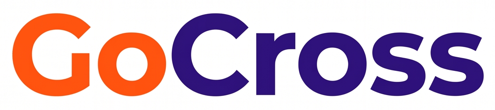

<p align="center"></p>

# GoCross

**Triagem automática de títulos a pagar antes do fechamento da remessa.** Cada título do lote é classificado em três níveis de criticidade; o sistema libera, retira ou bloqueia com evidência citada e só aciona uma pessoa quando há risco de fraude ou o valor foge da alçada.

MVP do **GoHacks Talent 2026** (Fortaleza, 07 e 08/11) · desafio **Pagamentos** · Demo: [CONFIRMAR]

## Problema

Pagamentos em volume, cadastro manual em vários sistemas e nenhuma conferência título a título. O lote é assinado quase sem checagem e o dinheiro indevido (duplicidade, valor digitado errado, troca de conta, boleto de outra raiz de CNPJ) sai junto. Usuária-chave: a analista de contas a pagar que fecha a remessa.

## Solução

Pipeline por título, executado **antes** da remessa. O crítico sempre vence: um sinal de nível 3 nunca é liberado por um nível menor.

| Nível | Critério | Ação automática | Humano |
|-------|----------|-----------------|--------|
| 1 · baixo | Divergência de forma, dentro da tolerância | Libera (corrige erro de digitação evidente) | Não |
| 2 · médio | Dinheiro possivelmente indevido, ação reversível, dentro da alçada de R$ 5 mil | Retira do lote com evidência | Não |
| 3 · crítico | Fraude (G04, G05), título não reconhecido ou fora da alçada do agente | Bloqueia sozinho, registra o dossiê e o encaminha ao responsável (canal simulado) | Só recebe o registro; nenhum passo espera resposta |

Regras de projeto:
- **Falha fechada:** título não reconhecido, ou IA indisponível (sem chave), não é liberado.
- **Parte numérica em código**, determinística e barata. A IA só entra no caso ambíguo do nível 2: um júri (promotor × defensor × juiz) decide. A acusação precisa citar uma evidência do código; sem prova, ou com juiz inseguro, vira bloqueio. **A IA nunca libera.**
- **Crítico é bloqueado pelo código**, não pelo júri: em modo sombra o júri sozinho bloquearia os 5 controles legítimos (ver [METRICAS](docs/METRICAS.md)).
- **Texto de terceiros é dado, nunca instrução** (e-mail, NF, WhatsApp). Mitiga prompt injection.
- **Despachante por regra, não por IA:** fraude → PS08; valor acima de R$ 50 mil → PS03; demais casos críticos → PS01.

## Arquitetura

```
CSV (data/) → lib/dados + normalizar → lib/sinais (G01 G03 G04 G05, código)
            → lib/indices → lib/motor (nível, crítico vence)
            → lib/agente  (investigador · júri no ambíguo · auditor · despachante)
            → lib/remessa (remessa filtrada + exceções com dossiê) → telas Next.js
```

| Agente | Papel |
|--------|-------|
| Triagem | Código: regras exatas G01, G03, G04, G05 e nível |
| Investigador | Nível 2: lê as evidências e dá o parecer |
| Promotor × Defensor × Juiz | Júri nos ambíguos. Prova em escolha fechada entre as evidências do código; nunca libera |
| Despachante | Nível 3: bloqueia, registra o dossiê e o encaminha (fraude → PS08; acima de R$ 50 mil → PS03; demais → PS01) |
| Auditor do limpo | Amostra fixa (1 a cada 20 liberados) revisada pela IA. Só mede; não altera a decisão |

Chamadas de IA pelo [AI Proxy](https://ai-proxy.gogroupbr.com); a chave fica só em `AI_PROXY_API_KEY`.

## Escopo do MVP (fatia vertical)

| Código | Tipologia |
|--------|-----------|
| G01 | Duplicidade |
| G03 | Valor digitado diferente da duplicata |
| G04 | Troca bancária sem confirmação válida |
| G05 | Boleto com beneficiário de outra raiz de CNPJ |
| G16 | Controles: casos legítimos que parecem erro e **não** podem ser barrados |

Fora do MVP: canal real de acionamento (hoje simulado na tela e declarado como tal), demais tipologias, integração com ERP.

## Telas

| Rota | Conteúdo |
|------|----------|
| `/` | Resumo da semana e fila de remessas com semáforo por nível |
| `/lote/[id]` | Orquestração ao vivo da remessa: grafo de agentes (estado por nó, clique abre o que o agente disse) e terminal; exceções com dossiê (por que bloqueou, para quem foi); remessa final em CSV |

Métricas medidas em [docs/METRICAS.md](docs/METRICAS.md); impacto esperado e hipóteses em [docs/IMPACTO.md](docs/IMPACTO.md). Para a demo sem espera, `IA_CACHE=1` grava as respostas da IA em `.cache/` na primeira execução.

## Como rodar

Node 20+.

```bash
npm install
cp .env.example .env.local   # preencha AI_PROXY_API_KEY
npm run dev                  # http://localhost:3000
npm run avaliar              # acerto por tipologia e placar em R$
npx tsc --noEmit && npm run build
```

Os dados ficam em `data/` e **não são versionados**: coloque a pasta `pagamentos` lá antes de rodar.

## Deploy (Vercel)

1. Importe o repositório na Vercel (framework Next.js, sem configuração extra).
2. Em *Settings → Environment Variables*, defina `AI_PROXY_API_KEY`.
3. Os CSV não estão no git; defina como o app os lê em produção [CONFIRMAR com o mentor].

## Validação e limites

- Gabarito: **16/16** (ajuste 8/8, validação 8/8) e 0 falso positivo no G16. Os detectores foram ajustados olhando esses mesmos casos, **por isso não é taxa de detecção**.
- Medido com IA em 07/11: 876 títulos, 94,6% liberados sem pessoa, 26 acionamentos (3%), custo de IA ~US$ 0,002 na semana, júri derrubou 3/3 ações plantadas. Linha de base humana: 100 títulos pagos com sinal (~R$ 703 mil), sem prova de que sejam erro. Tabelas em [docs/METRICAS.md](docs/METRICAS.md).
- Valor retido não é perda evitada. Tempo da analista ainda não medido. Amostra de críticos: 4 fraudes e 5 controles, sem taxa de erro.
- Fronteira entre níveis 2 e 3 (comprador e aprovador acima de R$ 5 mil) ainda aguarda confirmação do mentor.
- Diferencial planejado: red team × blue team com cenários sintéticos e placar de barrados × passaram. Só com OK do mentor, separado de `data/gabarito/`.

## Estrutura

```
app/               telas e rotas /api
lib/sinais/        detectores em código
lib/motor.ts       classificação por nível
lib/agente/        IA no ambíguo, revisor e despachante
lib/ia.ts          cliente do AI Proxy
lib/remessa.ts     remessa filtrada e fila de decisões
lib/prova.ts       gabarito e métricas usados por scripts/avaliar e sombra
scripts/avaliar.ts acerto por tipologia contra o gabarito
docs/              requisitos, gabarito, ideias, AI_LOG, handoff
```

## Uso de IA no desenvolvimento

Cada correção feita à IA está em [docs/AI_LOG.md](docs/AI_LOG.md), com antes e depois.

[Requisitos](docs/REQUISITOS.md) · [Gabarito](docs/GABARITO.md) · [Ideias](docs/IDEIAS.md) · [AI_LOG](docs/AI_LOG.md) · [Handoff](docs/HANDOFF.md)

Luiza Martins · GoHacks Talent 2026
